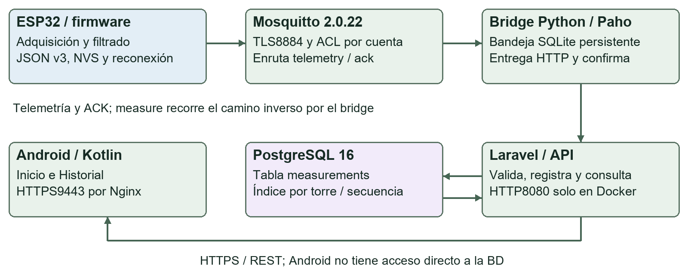
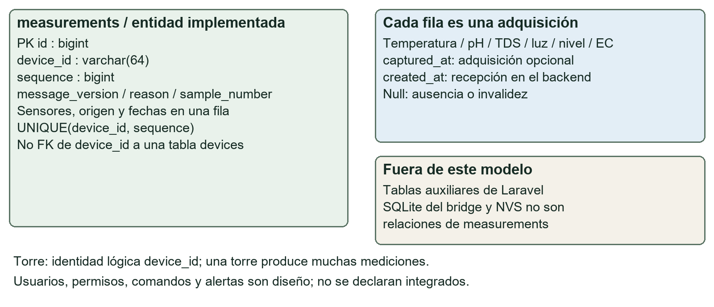
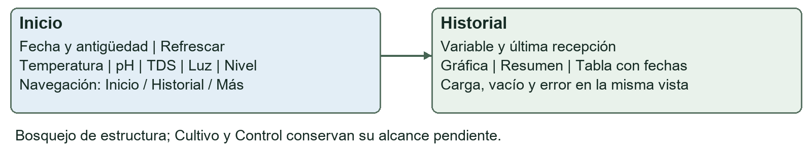

# Versión inicial integrada del software de HydroMate

Fecha:28/10/2026. Valdez Meza Kevin Osmar, matrícula1288703.

## 1. Alcance y módulos implementados

HydroMate integra sensores reales del ESP32 con MQTT TLS, Mosquitto, un bridge Python, Laravel, PostgreSQL y Android. El flujo físico público se demostró el 21 de octubre. Las compilaciones y pruebas locales se repitieron el 27 de octubre; este documento se cierra el 28 de octubre de 2026.

La integración de monitoreo está implementada. El firmware gobierna la bomba de recirculación con decisión local e interbloqueo físico por nivel, armada como en la práctica Proteus (D65). La dosificación A/B/pH Up/pH Down y el control remoto de actuadores siguen pendientes; solicitar una medición no controla salidas.

| Requisito general | Dónde se cumple |
|---|---|
| Repositorio organizado | embedded/, hydromate-backend/, mobile/, scripts/, deployment/, docs/ y talleres/ separan responsabilidades. |
| Módulos y responsabilidades | Figura 1 y tabla de la sección 2. Se distinguen los componentes implementados del diseño por desarrollar. |
| Procesos principales | Sección 3: pseudocódigo de adquisición, persistencia y consulta, incluyendo errores y reconexión. |

Figura 1. Comunicación implementada. Android consulta Laravel mediante Nginx; nunca accede directamente a PostgreSQL.



Fuentes: compose.production.yml, firmware HydroMateTelemetry, scripts/mqtt_bridge.py, rutas API y mobile/. Usuarios, FCM, BLE y actuación del T8 siguen siendo decisiones de diseño, no funciones acreditadas por este diagrama.

## 2. Responsabilidades y firmware

| Módulo | Responsabilidad implementada |
|---|---|
| ESP32 | Adquirir y filtrar sensores; JSON v3; secuencias y pendiente NVS; conexión MQTT y ACK; bomba de recirculación y alarma desde una tarea de seguridad. |
| Mosquitto | Autenticar cuentas, aplicar ACL y enrutar telemetry, ack y commands/measure. |
| Bridge Python | Bandeja SQLite durable, entrega HTTP y confirmación de persistencia. |
| Laravel | Validar, guardar, evitar duplicados y servir consultas y solicitudes acotadas. |
| PostgreSQL | Persistir mediciones, origen y fechas, con identidad única por torre/secuencia. |
| Android | Configurar conexión, navegar y presentar valores, fecha, historial y estados. |

| Requisito firmware | Evidencia y límite |
|---|---|
| Compilar sin errores | Compilación ESP32 Dev Module correcta el 28/10 con la salida: 1,077,213 bytes de flash (82%) y 50,828 de RAM (15%). Flasheado y probado por el responsable (P7). |
| Entrada física real | DS18B20 GPIO4; BH1750 I2C21/22; flotador GPIO27; pH ADS1115 A0 y TDS A1. Evidencia física del 21/10. |
| Protocolo definitivo | MQTT 3.1.1 con TLS8884, CA, hostname y reloj válido. Sin setInsecure ni fallback plano por Internet. |
| Salida o acción central | Bomba de recirculación: GPIO25 activo en bajo → NOR 74HCT02 con el flotador → MOSFET; alarma GPIO23. Arranca tras 5 s con agua confirmada y se apaga al instante con nivel bajo. Tarea FreeRTOS de seguridad separada de la red. Sin orden remota ni dosificación. |
| Formato definido | JSON v3, contrato en docs/TELEMETRY_CONTRACT.md: identidad, secuencia, sensores, origen y fechas. |
| Reconexión básica | Reintento Wi-Fi; un pendiente NVS inmutable; reenvío cada 5 s hasta stored. No almacena todas las transiciones sin red. |

TDS real en A1, filtrado y compensación DS18B20. Si falta temperatura válida, referencia de 25 °C identificada en Android; temperature_c permanece null/invalid. EC independiente sigue null/unavailable. No se acredita nueva calibración química.

## 3. Pseudocódigo de los procesos principales

### Adquisición y envío ESP32

```text
INICIAR: recuperar identidad, secuencias y pendiente de NVS.
ATENDER conexión Wi-Fi/MQTT, ACK y solicitud measure vigente.
LEER sensores, filtrar y marcar inválidos o ausentes con null.
SI no hay pendiente y hay inicio/cambio/plazo30s/solicitud:
  preparar JSON v3 y guardar objeto inmutable en NVS.
SI pendiente y conexión TLS y vence reintento5s: publicar.
SI stored de la misma secuencia: retirar pendiente.
SI rejected/conflict: conservar y detener para diagnóstico.
SIN RED: conservar pendiente; reconectar sin renumerarlo.
TAREA SEGURIDAD cada20ms: SIN agua → bomba OFF y alarma;
  CON agua 5s → bomba ON; sensor inválido → alarma.
```

### Bridge y backend

```text
RECIBIR mensaje autorizado y conservar en bandeja SQLite.
POST interno /api/measurements con objeto original.
201: confirmar stored y completar entrega.
409: consultar misma identidad y comparar campos enviados.
  Igual: stored. Diferente: conflict; no sobrescribir.
422 u otro4xx definitivo: rejected.
Timeout/desconexión/5xx: conservar y reintentar con espera.
Nunca confirmar persistencia solo por recepción MQTT.
```

### Consulta y presentación Android

```text
LEER entorno y device_id; producción requiere HTTPS.
CONSULTAR última medición e historial con real_only=1.
PENDIENTE: mostrar carga. SIN FILAS: mostrar vacío.
ERROR de red/HTTP/formato: mostrar error, sin fallback demo.
CON DATOS: mostrar valor, fecha, origen y antigüedad.
Null no es cero; una muestra antigua no se vuelve reciente.
NAVEGAR manteniendo entorno; consultar vistas visibles.
```

El botón de refrescar crea UUID con caducidad: API → bridge → commands/measure → ESP32 → adquisición correlacionada y guardada. No habilita actuadores. Fuentes: sketch, mqtt_bridge.py, MeasurementController.php y las clases de consulta/estado de Android.

## 4. Modelo de datos y creación de la base

Figura 2. Modelo preliminar de la entidad de telemetría. device_id es una identidad lógica; no una clave foránea declarada.



Cada fila de measurements representa una adquisición. Las variables y sus unidades se definen en el contrato; no se necesita una tabla por sensor. Las tablas auxiliares de Laravel no acreditan por sí mismas autenticación, perfiles ni relaciones de dominio terminadas.

| Requisito de base de datos | Dónde se cumple |
|---|---|
| Modelo preliminar | Figura 2: measurements, PK id y UNIQUE(device_id, sequence). |
| Diccionario principal | Sección 5: tipos, nulabilidad, unidades, significado y validaciones. |
| Base en servicio definitivo | PostgreSQL16 de HydroMate en VPS/Docker, red interna. Persistencia demostrada históricamente; sin inspección remota hoy. |
| Creación reproducible | Migraciones inicial, física v2 y parcial v3; deployment/deploy.sh ejecuta migrate --force. |
| Datos reales | 14 adquisiciones4201–4214 y muestras posteriores con TDS real; evidencia fechada21/10. |
| Registro y consulta | POST interno y GET de historial/última, con consulta por secuencia y restricción única. |

### Procedimiento para el administrador

Con respaldo verificado, archivos privados provisionados y checkout correcto, como deploy-hydromate sobre Docker rootless: el script aplica las migraciones pendientes sin borrar volúmenes ni usar fresh/reset.

```text
sh deployment/deploy.sh /etc/hydromate/.env --mqtt --public
# Operación incluida en el script:
php artisan migrate --force --no-interaction
```

PHPUnit recreó el esquema solo en SQLite :memory:. Eso verifica las migraciones y comportamiento de prueba, pero no equivale a ejecutar una migración observada en PostgreSQL remoto.

## 5. Diccionario principal de telemetría

Tipos tomados de las migraciones Laravel. La nulabilidad de almacenamiento no permite omitir claves obligatorias del mensaje v3: deben aparecer las seis variables y los seis orígenes. Los rangos son límites del prototipo, no metas de cultivo.

| Columna y tipo | Null / unidad | Significado y validación v3 |
|---|---|---|
| id / bigint PK | No / — | Identificador generado de fila. |
| device_id / varchar(64) | No / — | Torre; texto hasta64. MQTT/rutas acotan letras, dígitos, _ y -. |
| sequence / bigint | No / — | Entero positivo hasta9223372036854775807. Único junto a device_id. |
| message_version / smallint | Sí / — | Enviar entero3 para v3. Nullable por compatibilidad. |
| sample_number / bigint | Sí / — | Contador opcional positivo heredado; no reemplaza sequence. |
| reason / json | Sí / — | Lista opcional, máximo10 textos de64; motivo periódico, cambio o request:UUID. |
| temperature_c / decimal(5,2) | Sí / °C | 0–50; DS18B20. Null si inválido o ausente. |
| light_lux / decimal(10,2) | Sí / lux | 0–100000; BH1750. No porcentaje ni PAR. |
| water_present / boolean | Sí / — | true/false del flotador. false es lectura válida; null requiere origen inválido/ausente. |
| ph / decimal(4,2) | Sí / sin unidad | 0–14. Conversión histórica, sin nueva calibración. |
| tds_ppm / decimal(8,2) | Sí / ppm | 0–1000; TDS A1 real. No equivale a EC. |
| ec_us_cm / decimal(10,2) | Sí / µS/cm | 0–100000 permitido. Actualmente null/unavailable. |

En v3 los valores numéricos son números JSON, con máximo dos decimales, nunca cadenas. sources=real/simulated requiere valor; unavailable/invalid requiere null. El origen lo declara el productor y no prueba autenticidad física por sí solo.

Fuentes: hydromate-backend/database/migrations/, StoreMeasurementRequest.php y docs/TELEMETRY_CONTRACT.md. No se incorporan tablas o índices avanzados para funciones todavía no implementadas.

## 6. Fechas y operaciones del backend

| Columna y tipo | Null | Significado |
|---|---|---|
| sources / json | Sí en BD | v3 exige seis claves: real, simulated, unavailable o invalid. |
| captured_at / timestampTz | Sí | Adquisición UTC opcional; YYYY-MM-DDTHH:mm:ssZ, hasta1min en futuro. |
| created_at / timestamp | Sí en esquema | Recepción asignada por Laravel. No confundir con adquisición. |
| updated_at / timestamp | Sí en esquema | Mantenida por Eloquent; no sustituye captured_at. |
| light_pct / decimal(5,2); light_state / varchar(10) | Sí | Compatibilidad v1. Prohibidos en POST físico v2/v3. |
| water_level_pct / decimal(5,2); water_level_state / varchar(10) | Sí | Compatibilidad v1; no es un porcentaje real del flotador. |

| Operación implementada | Acceso y respuesta |
|---|---|
| POST /api/measurements | Bridge interno, JSON v3. 201 guardado;422 validación;409 duplicado. |
| GET /api/measurements | HTTPS; device_id, limit1–100, real_only y sequence opcional. Array; [] sin filas. |
| GET /api/measurements/latest | HTTPS; device_id y real_only=1. Objeto;404 sin datos. |
| GET /api/devices/{id}/status | HTTPS. no_data/recent/stale según antigüedad, no presencia MQTT. |
| POST /api/devices/{id}/measurement-requests | HTTPS acotado, cuerpo{}. Torre conocida;202/UUID, 12/min;404/422/429. |
| GET /api/measurement-requests/{uuid} | HTTPS. pending/stored/expired; stored lleva adquisición correlacionada. |
| GET /api/internal/measurement-requests | Red interna, recuperada por bridge; no expuesta por Nginx. |

Laravel recibe y valida datos reales antes de persistir con Eloquent. Errores con estado HTTP y descripción por campo; Android no recibe credenciales de BD. Documentación breve ampliada: docs/API.md e INTEGRATION.md.

Seguridad actual: TLS y cuentas/ACL MQTT, más escritura de mediciones restringida a red interna. No hay sesión completa de usuarios en Android. Antes de habilitar acciones físicas de riesgo deben incorporarse autorización y seguridad correspondientes; Sanctum instalado no equivale a flujo terminado.

## 7. Frontend y evidencia de datos reales

Figura 3. Bosquejo de la estructura de Inicio e Historial y navegación entre pantallas.



| Requisito frontend | Implementación y evidencia |
|---|---|
| Bosquejo de pantallas | Inicio → Historial; Cultivo, Control y Más/Conexión. Dirección actual en docs/AERO_DESIGN.md. |
| Una o dos pantallas | Inicio e Historial funcionales. Vistas de funciones futuras no acreditan actuación implementada. |
| Comunicación real | Repositorio HTTPS, URL configurable; evidencia física ESP32→VPS→Android del21/10. |
| Actual e historial | Lectura con fecha/origen y registros almacenados. D64 añade gráfica, resumen y tabla. |
| Carga, vacío y error | ReadingState.kt y pruebas de repositorio; sin fallback automático a demo en producción. |
| Navegación básica | Barra de destinos y configuración por entorno; revisión visual documentada27/10. |

Capturas: talleres/taller-05/entrega-2026-10-21/evidencias/android-inicio.png y android-historial.png, desde raíz del repositorio.

Figuras 4 y 5. Capturas físicas del 21/10: datos reales en Inicio e Historial. La interfaz fue actualizada el 27/10; estas imágenes demuestran el flujo anterior, no una nueva adquisición de hoy. La aceptación de la UI actual está en docs/AERO_ACCEPTANCE.md.

Quedan sin verificar arrastre de gráfica, detalle por fila, ayudas y TalkBack. Los ajustes avanzados pueden completarse en beta según el alcance docente; no se presentan como pruebas realizadas.

## 8. Plan preliminar de pruebas

Conservar estos casos por incremento. Los mensajes incorrectos o sintéticos se prueban en un entorno aislado y no con la identidad física en producción.

| Caso / entorno | Procedimiento y resultado esperado | Estado |
|---|---|---|
| P1 Flujo real / físico | Adquirir; seguir device_id/sequence hasta stored, GET e Inicio/Historial. Valor y fecha coinciden. | Evidencia real21/10; recuperación confirmada por responsable. |
| P2 Inválido / local | Enviar ph=50 o número como cadena. HTTP422 con error; no se guarda. | Cubierto por PHPUnit27/10. |
| P3 Duplicado / local | Reenviar identidad; no crear otra fila. Bridge solo stored si coincide contenido. | API y bridge probados; integración anterior. |
| P4 Reconexión / físico | Cortar y restaurar Wi-Fi. Pendiente conserva identidad y llega sin duplicarse. | Comprobada por el responsable; confirmación28/10. |
| P5 Estados Android / local | Vacío, errorHTTP, null y lectura antigua. Estado correcto sin inventar valores. | JVM27/10; interacción manual parcial. |
| P6 Reinicio ESP32 / físico | Reiniciar ESP32; comprobar continuidad sin conexión y recepción de las mediciones recientes sin duplicados al recuperarla. | Comprobado por el responsable; confirmación28/10. |
| P7 Bomba / físico | Arranque con agua tras 5 s; nivel bajo apaga y enciende alarma; recuperación reanuda; reinicio ESP32 sin arranque; telemetría continúa. | Comprobado por el responsable; confirmación28/10, sin fotografía. |

El responsable confirmó el 28/10 que reinició el ESP32, que siguió funcionando sin conexión y que al recuperarla llegaron las mediciones más recientes sin duplicarse. Esta comprobación corresponde al ESP32 y la recuperación de telemetría; no acredita un reinicio del bridge ni un historial completo de lecturas durante el corte.

### Resultados locales del 27 de octubre

| Validación | Resultado observado |
|---|---|
| Firmware | Compilación correcta28/10:82% flash,15% RAM. Prueba C++ de la lógica de bomba: aprobada. |
| PHPUnit / SQLite :memory: | 29 pruebas,194 comprobaciones; cero fallos. |
| Python / bridge, puertos y guardas | 10 pruebas; cero fallos ni omisiones, con Git Bash y mocks. |
| Android / JVM, lint y build | 39 casos:35 ejecutados y4 opt-in omitidos. Cero fallos. Lint, debug y release correctos. |
| Compose producción | Aislamiento validado con fixtures; no servicios iniciados ni acceso VPS. |

Resumen: validacion-local.json. Las pruebas Android opt-in omitidas no verifican el flujo público actual. Compilaciones y tests no sustituyen montaje ni calibración; la prueba física de la bomba es P7.

## 9. Tecnologías y variables de configuración

| Tecnología | Versión principal / fuente |
|---|---|
| ESP32 / Arduino | Core3.3.11; ArduinoJson7.4.2; PubSubClient2.8. embedded/README.md. |
| Laravel / PHP | Laravel13.33.0 en composer.lock; PHP8.4 imagen y PHP8.4.26 local. |
| PostgreSQL / Mosquitto | PostgreSQL16; imagen propia basada en eclipse-mosquitto:2.0.22. |
| Bridge Python | Paho MQTT2.1.0, scripts/requirements-mqtt.txt. |
| Android | Kotlin/vistas nativas; AGP9.3.1, Gradle9.5.0, compileSDK37, target35, min26. App0.7.0-integration. |
| Pruebas | PHPUnit12.5.35 observado; JUnit4.13.2. Resto en lockfiles/configuración. |

Solo se muestran direcciones públicas y nombres de variables. Los valores privados se guardan fuera de Git; no se solicitan por chat ni aparecen en las capturas.

| Archivo / ámbito | Configuración |
|---|---|
| .env.example raíz | HYDROMATE_APP_URL: https://hydromate-kevin.duckdns.org:9443, sin /api. Inventario de variables de despliegue en variables-entorno.md. |
| /etc/hydromate/.env privado | ClaveLaravel, contraseñas de rolesBD/bridge y opciones de despliegue. Conservar claves existentes; editar env no rota una contraseña de BD inicializada. |
| /etc/hydromate/https y mqtt | HTTPS: fullchain.pem/privkey.pem. MQTT: fullchain.pem/privkey.pem/passwd. Mounts read-only y permisos del usuario interno. |
| secrets.h privado ESP32 | WIFI_SSID/PASSWORD; MQTT_HOST/PORT/USER/PASSWORD/TLS/ROOT_CA; DEVICE_ID. Producción TLStrue, puerto8884 y hydromate-01. |
| Android | Perfiles desarrollo/producción separados; producción HTTPS y real_only=1. No copiar el env de VPS al teléfono. |

Docker rootless, proyecto hydromate. API loopback8081, MQTT 1884 y BD 5432 internos; públicos HTTPS 9443 y MQTT TLS 8884. No operar servicios ajenos, puertos reservados o configuración global del host.

## 10. Compilación y ejecución reproducibles

Desde C:\Hydromate, reutilizar herramientas instaladas. .local y SDK son privados de esta PC y deben comprobarse en una clonación nueva. No ejecutar composer setup indiscriminadamente: genera claves y aplica migraciones.

### Backend y Android

```text
# PowerShell: pruebas backend aisladas, sin PostgreSQL remoto
Push-Location .\hydromate-backend
& ..\.local\php\php.exe vendor\bin\phpunit --testdox
Pop-Location
$env:JAVA_HOME='C:\Program Files\Android\Android Studio\jbr'
& .\mobile\gradlew.bat -p mobile :app:testDebugUnitTest `
  :app:lintDebug :app:assembleDebug :app:assembleRelease --console=plain
```

### Firmware sin flashear

```text
$cli="$env:LOCALAPPDATA/Programs/Arduino IDE/resources/" +
     "app/lib/backend/resources/arduino-cli.exe"
& $cli compile --config-file C:/Hydromate/.local/arduino-cli.yaml `
  --jobs 2 --fqbn esp32:esp32:esp32 `
  --libraries C:/Hydromate/.local/arduino-libraries `
  --build-path C:/Hydromate/.local/firmware-build `
  C:/Hydromate/embedded/HydroMateTelemetry
```

### Pruebas MQTT y configuración

```text
$env:HYDROMATE_TEST_SHELL='C:/Program Files/Git/usr/bin/bash.exe'
& .\.local\mqtt-venv\Scripts\python.exe -m unittest discover `
  -s scripts -p 'test_*.py'
& .\.local\mqtt-venv\Scripts\python.exe scripts/verify_production_compose.py
```

Compose requiere Docker CLI en PATH; usa fixtures y no inicia contenedores. Arranque de banco: scripts/start_local.ps1, tras examinar procesos/volúmenes. Producción: deployment/deploy.sh y guías PUBLIC_ACCESS/PRODUCTION, solo por el administrador. Compilar no requiere USB.

## 11. Evidencias y pendientes de cierre

| Fuente en el repositorio | Qué acredita |
|---|---|
| docs/evidence/public-flow-esp32-android-2026-10-21.json | 14 adquisiciones4201–4214 confirmadas y comparadas con API. SAMPLE→STORED258–577ms, media409ms; no incluye pantalla. |
| docs/evidence/tds-events-2026-10-21.json | TDS A1/temperatura reales comparados con API; no calibración química. |
| talleres/taller-05/entrega-2026-10-21/evidencias/ | Capturas, video, registros y fotos del banco. |
| docs/AERO_ACCEPTANCE.md y docs/evidence/ux-2026-10-27/ | Aceptación visual de la interfaz actual y límites de interacción manual. |
| hydromate-backend/database/migrations/ y tests/ | Esquema reproducible y comportamiento automatizado. |
| Esta entrega: validacion-local.json y diagramas/ | Resultados locales27/10, huellas de fuentes y figuras SVG editables. |

Los datos sintéticos de las suites no sustituyen el flujo físico documentado. Un ensayo antiguo no demuestra disponibilidad actual de la VPS. No se accedió por SSH ni se ejecutaron operaciones remotas en esta preparación.

### Comprobación de reconexión y reinicio

Prueba realizada por el responsable del proyecto y confirmada el 28/10: reinicio del ESP32, continuidad de funcionamiento sin conexión y entrega de las mediciones más recientes sin duplicados al recuperarla. La fecha exacta de ejecución no fue indicada. La evidencia real previa de la app se conserva con su fecha original.

### Comprobación de la salida de bomba

Prueba realizada por el responsable del proyecto y confirmada el 28/10, con el circuito armado como en la práctica Proteus y el firmware de esta entrega: la bomba arrancó con agua, se detuvo con nivel bajo encendiendo la alarma, se reanudó al recuperar el nivel, no arrancó durante el reinicio y la telemetría continuó. No se conserva fotografía, video ni registro serie; no se midió corriente de arranque.

### Comprobaciones que siguen abiertas

| Pendiente | Criterio para cerrarlo |
|---|---|
| Dosificación y control remoto | Canales A/B/pH Up/pH Down con límites de dosis, exclusión Up/Down y tiempos máximos; autorización antes de cualquier orden remota. |
| Interacción y accesibilidad | Arrastre, detalle, ayudas y TalkBack. Ajustes avanzados pueden quedar para beta según alcance docente. |

FCM, BLE, perfiles completos, todas las pantallas o calibración terminada no son necesarios para los mínimos de monitoreo de esta etapa. Si se incorpora actuación de riesgo, primero deben implementarse autorización y protecciones correspondientes.

La entrega valida lo implementado, incluida la bomba de recirculación, y conserva la dosificación como requisito abierto. Fuentes: código del repositorio, T5/T8 y evidencias fechadas; los resultados locales no se presentan como nuevas pruebas físicas.